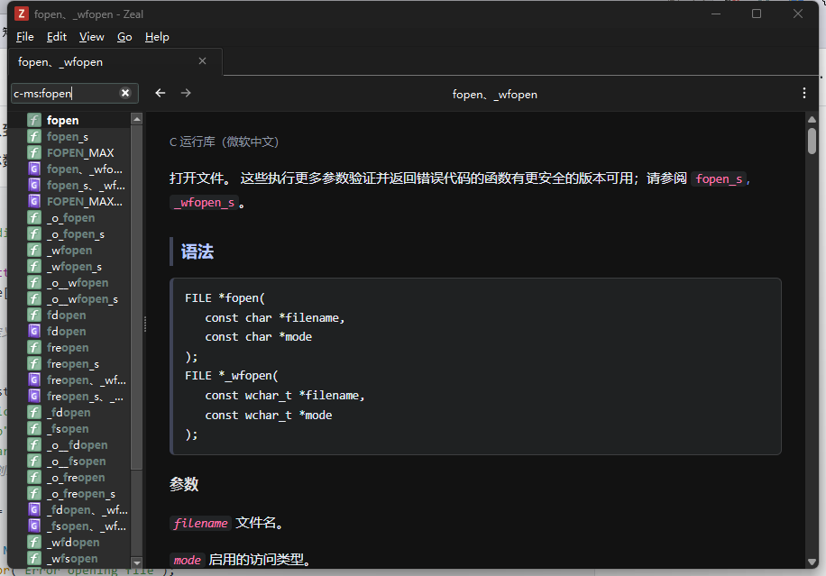
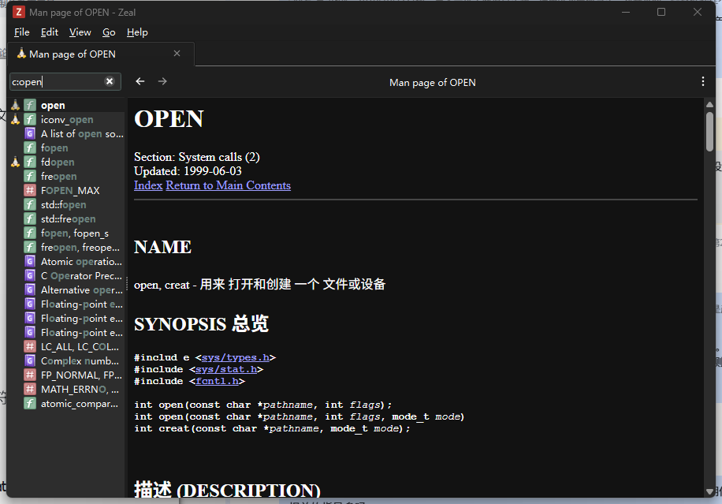
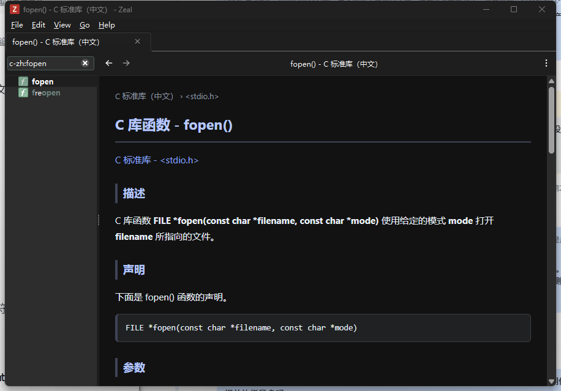

# 中文 C 标准库文档集（Zeal / Dash）

让在 VS Code 里查 C 标准库函数时，能弹出**中文**的详细文档 —— 参数怎么填、返回值什么含义、失败时 errno 是什么。

配合 [Zeal](https://zealdocs.org/)（离线文档浏览器）和 VS Code 扩展
[`deerawan.vscode-dash`](https://marketplace.visualstudio.com/items?itemName=deerawan.vscode-dash) 使用：
光标放在函数名上按 `Ctrl+H`，直接弹出对应的中文文档页。

## 为什么需要这个

VS Code 里悬停在 `fopen` 上只显示：

```
FILE *fopen(const char *__restrict __Filename, const char *__restrict __Mode)
provided by <stdio.h>
```

**这不是插件的问题，是"文档源"的问题。** hover 显示的不是"查来的文档"，而是 cpptools
/ clangd **从源码里解析出来的签名**。MinGW 的 `stdio.h:571` 那一行上面一行注释都没有：

```c
_CRTIMP FILE *__cdecl fopen(const char * __restrict__ _Filename,const char * __restrict__ _Mode) __MINGW_ATTRIB_DEPRECATED_SEC_WARN;
```

所以它只能显示返回类型、参数名、参数类型。对照组：`std::vector::push_back` 的 hover 很长，
因为 libstdc++ 的头文件里写满了 `///` doxygen 注释 —— **差别在文档源，不在插件**。

想看到"参数怎么填、返回值什么含义"，只有两条路：换一个自带完整注释的头文件（比如 MSVC 的），
或者干脆把文档查到编辑器外面去 —— 就是本仓库做的事。

## 三个文档集

| 文档集 | 内容 | 页数 | 大小 | 关键词 |
| --- | --- | --- | --- | --- |
| `C-win-zh` | 微软《C 运行库参考》中文版，覆盖最全最权威 | 955 | 6.2 MB | `c` `c-ms` |
| `C-man-zh` | 中文 man 手册里的 POSIX 部分（open/read/write/close/accept/execve…） | 33 | 17 MB | `c` `c-man` |
| `C-zh-cn` | 菜鸟教程 C 标准库（**本仓库不预置，需自行构建**，见下方版权说明） | 181 | 1.4 MB | `c` `c-zh` |

三份的 `DocSetPlatformFamily` 都是 `c`，所以扩展发出的 `keys=c` 能同时命中它们；
各自又有一个专属关键词（`c-ms` / `c-man` / `c-zh`），想在 Zeal 里单独搜某一个时可以用。

命中优先级由 Zeal 的评分决定 —— 它按**名字长度**打分，名字越短分越高，
所以 `fopen` 会优先命中菜鸟/微软的 `fopen` 页。同一个查询的其它候选都在 Zeal 左侧结果列表里，
点一下就能切换。

### 效果

微软《C 运行库参考》（`c-ms`）：



中文 man（`c-man`）：



菜鸟教程（`c-zh`，需自行构建）：



## 快速开始

### 1. 装 Zeal

```powershell
winget install --id OlegShparber.Zeal -e
```

装完先启动一次 Zeal，让它把目录建出来。

### 2. 装 VS Code 扩展

```powershell
code --install-extension deerawan.vscode-dash
```

然后在 `settings.json` 里加一条映射 —— 因为扩展**默认没有把 `.c` 文件映射到 `c` 文档集**
（`dash.languageIdToDocsetMap` 里只有 `cpp`，而 `cpp` 的值里才含 `c`），不加的话 `.c` 文件
发出的 `keys` 是空的，Zeal 会去搜**全部**文档集。

```jsonc
// 注意：object 型配置会整体替换默认值，所以扩展自带的 5 条也要一起抄回来
"dash.fileNameToDocsetMap": {
  "[dD]ocker*": ["docker"],
  "Vagrantfile": ["vagrant"],
  "gruntfile.js": ["grunt"],
  "gulpfile.js": ["gulp"],
  "*.ino": ["arduino"],
  "*.c": ["c"],
  "*.h": ["c"]
}
```

### 3. 装文档集

把 `.docset` 目录整个复制到 Zeal 的文档集目录：

```
Windows:  %LOCALAPPDATA%\Zeal\Zeal\docsets\
Linux:    ~/.local/share/Zeal/Zeal/docsets/
macOS:    ~/Library/Application Support/Zeal/Zeal/docsets/
```

（这个路径来自 Zeal 源码 `src/libs/core/settings.cpp` 的
`QStandardPaths::writableLocation(AppLocalDataLocation) + "/docsets"`。）

本仓库的 `docsets/` 下已经打包好了两个可以直接用的：

```powershell
# 解压到 Zeal 的文档集目录
$dst = "$env:LOCALAPPDATA\Zeal\Zeal\docsets"
tar -xzf docsets\C-win-zh.docset.tgz  -C $dst
tar -xzf docsets\C-man-zh.docset.tgz  -C $dst
```

**装之前一定要先退出 Zeal。** 否则 Zeal 占着 `docSet.dsidx` 文件，
复制/删除会失败，或者留下一个残缺的文档集 —— 后果是 Zeal 静默跳过它，
而且因为关键词匹配不到任何文档集，Zeal 会**回落到搜索全部文档集**，看起来像"还能用"，
非常难排查。

装完重启 Zeal 即可。

### 4. 用

光标放在函数名上：

| 快捷键 | 作用 |
| --- | --- |
| `Ctrl+H` | 用当前语言的文档集搜 |
| `Ctrl+Alt+H` | 搜全部文档集 |
| `Ctrl+Shift+H` | 用当前语言、不带关键词搜 |
| `Alt+H` | 输入自定义关键词 |

> ⚠️ VS Code 内置的 `Ctrl+H` 是「查找替换」。扩展键位和内置键位冲突时谁生效取决于 `when` 条件的
> 匹配情况，**这一点本仓库没有实测过**。如果按下 `Ctrl+H` 弹出的是查找替换而不是 Zeal，
> 改用 `Ctrl+Alt+H`（搜全部文档集），或在「键盘快捷方式」里给 `extension.dash.specific` 换一个键。

## 自己构建

```powershell
# 依赖：Python 3.9+、curl、node 不需要
pip install --target ./pylibs markdown
$env:PYTHONPATH = "$PWD\pylibs"

python scripts/build_mslearn.py work/mslearn   # 微软 C 运行库参考（955 页）
python scripts/build_man_zh.py   work/manzh    # 中文 man 的 POSIX 部分（33 页）
python scripts/build_runoob.py   work/runoob   # 菜鸟教程 C 标准库（181 页）
```

产物统一落在 `work/../build/` 下。抓下来的页面会缓存在 `work/<名字>/` 里，
重跑时直接复用，不会重复下载。

三个脚本都只依赖标准库 + `markdown`，各自独立，可以只跑想要的那份。
`build_man_zh.py` 会自动跳过菜鸟那份已收录的同名函数（如果 `build/C-zh-cn.docset` 存在）。

## 目录结构

```
scripts/
  docset_lib.py       构建 docset 的公共部分（Info.plist / 索引 / 模板 / 首页）
  build_mslearn.py    微软 C 运行库参考
  build_man_zh.py     中文 man 的 POSIX 部分
  build_runoob.py     菜鸟教程 C 标准库
docsets/              预置好的 .docset.tgz（只有版权允许公开分发的那两份）
docs/img/             README 里的截图
```

## 踩过的坑（都写进代码注释了，这里列结论）

**一个 Zeal 文档集最少只要三样东西：**

```
<name>.docset/Contents/Info.plist
<name>.docset/Contents/Resources/docSet.dsidx      ← SQLite
<name>.docset/Contents/Resources/Documents/        ← HTML
```

`docSet.dsidx` 里只要有一张 `searchIndex` 表（列 `name, type, path`）就会被 Zeal 当成
Dash 型文档集。Zeal 的查询是 `SELECT name, type, path, '' FROM searchIndex ...`，
**不需要** Dash 格式里那个 `fragment` 列。

**Zeal 的排序是"名字越短分越高"。** 两种查询模式都是：

```sql
-- fuzzy 开
SELECT name,type,path,'',zealScore(?,name) as score FROM searchIndex WHERE score>0 ORDER BY score DESC
-- fuzzy 关
SELECT name,type,path,'',-length(name) as score FROM searchIndex WHERE (name LIKE ?) ORDER BY score DESC
```

所以搜 `fopen` 时，同文档集里的 `FOPEN_MAX`（9 字符）会排在 `fopen, fopen_s`（15 字符）前面。
这是 Zeal 的行为，配置改不了。

**关键词一个都没命中时会回落到搜全部文档集。** 见 `src/libs/registry/docsetregistry.cpp`
的 `runQuery`：query 带关键词且有文档集命中 → 只搜那些；**一个都没命中 → 搜全部**。
这个"优雅降级"是排查配置问题时最大的干扰源。

**给 learn.microsoft.com 加 `Accept: text/markdown` 会直接返回 markdown 源文。**
比抓 HTML 干净得多 —— 没有导航栏、侧边栏、脚本、广告，正文结构完整。
`build_mslearn.py` 就是靠这个把 955 页抓下来的（总共只要 6.2 MB）。

**换文档集前必须先退出 Zeal。** 否则 `Remove-Item` 会报
`The process cannot access the file '...\docSet.dsidx' because it is being used by another process`。

**Zeal 的窗口标题是惰性更新的。** 查询没有结果时 Zeal 会停在上一个页面，
标题留着上一页的 —— 自动化测试时看着像"匹配错了"。要等几秒再复测。

## 版权

| 内容 | 来源 | 许可 |
| --- | --- | --- |
| 构建脚本、`docset_lib.py` | 本仓库 | MIT，见 [LICENSE](LICENSE) |
| `C-win-zh`（微软 C 运行库参考） | [learn.microsoft.com](https://learn.microsoft.com/zh-cn/cpp/c-runtime-library/) | 文档为 CC BY 4.0，此处保留出处 |
| `C-man-zh`（中文 man） | [quericy/Zeal-docset-CN](https://github.com/quericy/Zeal-docset-CN)，源自 man-pages 项目的中文翻译 | GPL，此处保留出处 |
| `C-zh-cn`（菜鸟教程） | [runoob.com](https://www.runoob.com/cprogramming/c-standard-library.html) | **菜鸟教程正文有版权，本仓库不预置构建产物**，只提供 `build_runoob.py`。请自行运行生成，仅用于个人学习查阅 |

`docsets/` 里只放版权允许公开分发的那两份。菜鸟那份如果你自己构建了，
建议不要公开分发。
